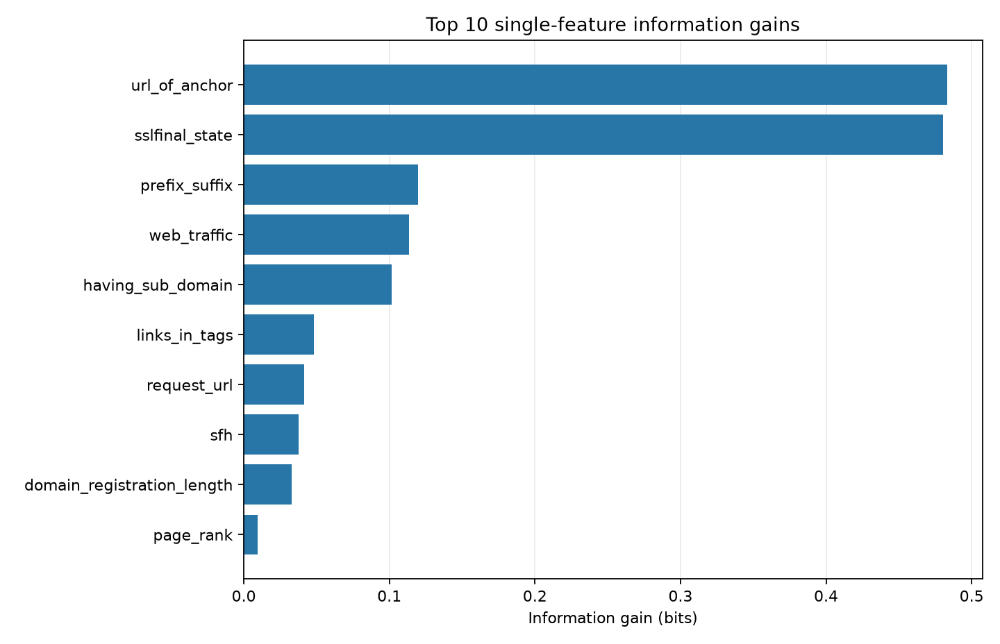
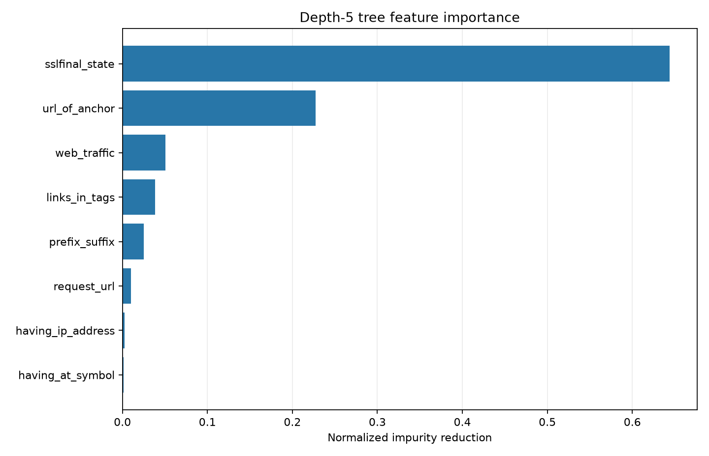

# PhishGuard ML

PhishGuard ML is a completed COMP 151 experiment comparing an entropy-based Decision Tree, K-nearest neighbors (KNN), and a majority-class baseline on the [UCI Phishing Websites dataset](https://archive.ics.uci.edu/dataset/327/phishing+websites). It classifies the dataset's precomputed website characteristics; it does not visit websites or scan live URLs.

## Problem and motivation

Phishing pages can imitate legitimate sites. This project asks how two familiar classifiers perform on a historical, labeled dataset and which recorded characteristics help distinguish the classes. Missing a phishing site and falsely flagging a legitimate site have different costs, so the comparison reports phishing precision, recall, and F1 alongside accuracy.

## Dataset and evaluation design

UCI dataset ID 327 contains **11,055 observations and 30 integer-coded, categorical website features**. They describe URL and domain properties, page and link behavior, and external signals such as traffic or search indexing. The input is a feature table, not raw web content. The original numeric labels are preserved. The working interpretation is **`-1 = phishing` and `1 = legitimate`**, with a [published label-mapping disagreement](docs/CHECKPOINT_1B_EVALUATION_PROTOCOL.md) described below.

The fixed seed 42 produces 7,676 training, 1,629 validation, and 1,750 held-out test observations (approximately 70/15/15). Records are grouped by **all 30 feature values**, without using the label to define a group. Identical feature vectors stay in one partition; all records, including duplicates and 64 conflicting-label feature groups, remain in the experiment. Training fits the models, validation compares settings, and the test partition is used once after the protocol was frozen. See the [evaluation protocol](docs/CHECKPOINT_3B_TEST_PROTOCOL.md) and [final evaluation](docs/CHECKPOINT_3C_FINAL_EVALUATION.md).

## Models and final held-out results

The majority baseline learns its label from training data. Both trees use scikit-learn's `DecisionTreeClassifier(criterion="entropy", random_state=42)`; this is not an exact implementation of ID3. KNN uses `n_neighbors=9` and Hamming distance, which counts differences across the 30 discrete feature values. **KNN k=9 was selected by validation phishing F1 before test evaluation.** The unrestricted tree and depth-5 tree were retained for the planned comparison and feature analysis.

| Model | Test accuracy | Phishing precision | Phishing recall | Phishing F1 |
| --- | ---: | ---: | ---: | ---: |
| Majority-class baseline | 0.5526 | 0.0000 | 0.0000 | 0.0000 |
| Entropy tree, depth 5 | 0.9211 | 0.9562 | 0.8633 | 0.9074 |
| Entropy tree, unrestricted | 0.9200 | 0.9004 | 0.9234 | 0.9117 |
| **KNN, k=9, Hamming** | **0.9251** | 0.9347 | 0.8953 | **0.9145** |

Accuracy is the fraction of all correct predictions; phishing F1 combines phishing precision and recall using `-1` as the positive class. The confusion matrices, prediction times, validation comparison, and full-precision values are in the [final evaluation report](docs/CHECKPOINT_3C_FINAL_EVALUATION.md) and [saved results](results/checkpoint3c/final_evaluation.json).

## Feature analysis

Training-only, empirical information gain ranks `url_of_anchor` (0.4832 bits) and `sslfinal_state` (0.4804 bits) highest as *individual* features. The depth-5 tree instead gives `sslfinal_state` the greatest normalized tree importance (0.6441). These measures answer different questions: information gain considers each feature alone; tree importance sums the impurity reductions in that fitted tree. Neither establishes causation. See the [feature analysis report](docs/CHECKPOINT_3A_FEATURE_ANALYSIS.md).





## Repository structure

| Path | Purpose |
| --- | --- |
| `phishguard/` | Dataset loader, group-safe split, models, analysis, and frozen final protocol |
| `scripts/` | Dataset inspection, validation, feature analysis, and final evaluation entry points |
| `tests/` | Offline automated tests |
| `results/checkpoint3a/` | Saved analysis and charts |
| `results/checkpoint3c/` | Saved held-out evaluation JSON |
| `docs/` | Checkpoint records and the [final research report](docs/FINAL_PROJECT_REPORT.md) |

## Install and reproduce

Use **Python 3.11+** from the repository root. Replace `python3.11` with a newer installed Python version if needed:

```bash
python3.11 -m venv .venv
source .venv/bin/activate
python -m pip install -r requirements.txt
```

These commands fetch the official UCI dataset (ID 327), so they require network access. Dataset inspection prints schema and quality checks; validation reproduces the model comparison; feature analysis regenerates the charts and analysis JSON under `results/checkpoint3a/`.

```bash
python -m scripts.inspect_dataset
python -m scripts.validate_models
python -m scripts.analyze_features
```

The completed held-out evaluation is already recorded in [saved JSON](results/checkpoint3c/final_evaluation.json). The final evaluation script intentionally refuses to overwrite that file, protecting the one-time test result.

Run the existing offline suite without downloading data:

```bash
python -m pytest -q
```

For methods, numerical examples, error analysis, and references, read the [final research report](docs/FINAL_PROJECT_REPORT.md).

## Limitations, attribution, and licensing

This is a **historical academic benchmark, not a production phishing detection system**. No live phishing sites are visited. Identical feature vectors with conflicting labels, unavailable website identities and dates, and changes in phishing techniques limit what the scores imply about new sites. The published class-name mapping is disputed, and UCI's available metadata does not explicitly resolve it; phishing-class metrics use the declared working interpretation, while the original labels and numeric results remain unchanged. See the [label evidence](docs/CHECKPOINT_1B_EVALUATION_PROTOCOL.md) and [report limitations](docs/FINAL_PROJECT_REPORT.md#limitations-and-conclusions).

Dataset: Mohammad, R. & McCluskey, L. (2012). *Phishing Websites*. UCI Machine Learning Repository. [DOI: 10.24432/C51W2X](https://doi.org/10.24432/C51W2X). The dataset is licensed [CC BY 4.0](https://creativecommons.org/licenses/by/4.0/). The repository does not currently declare a separate license for its code.
