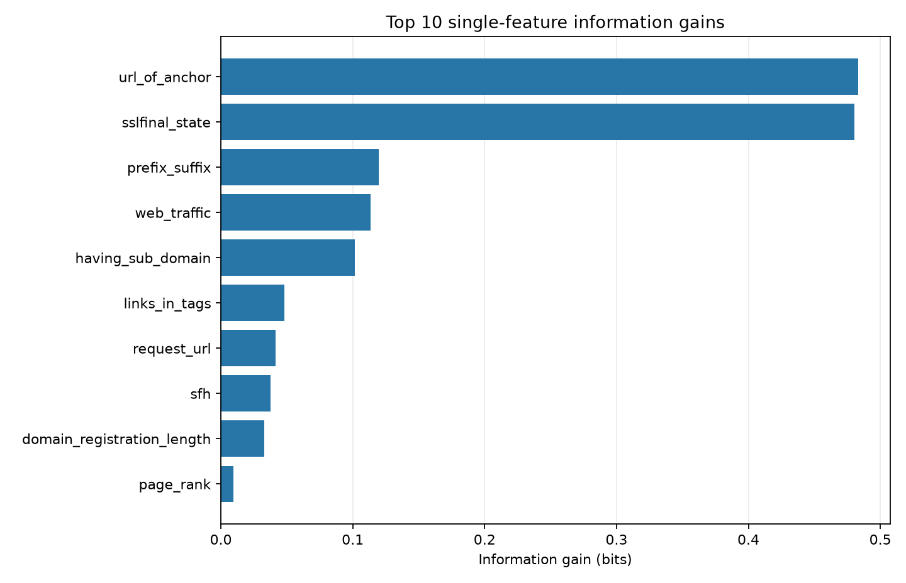
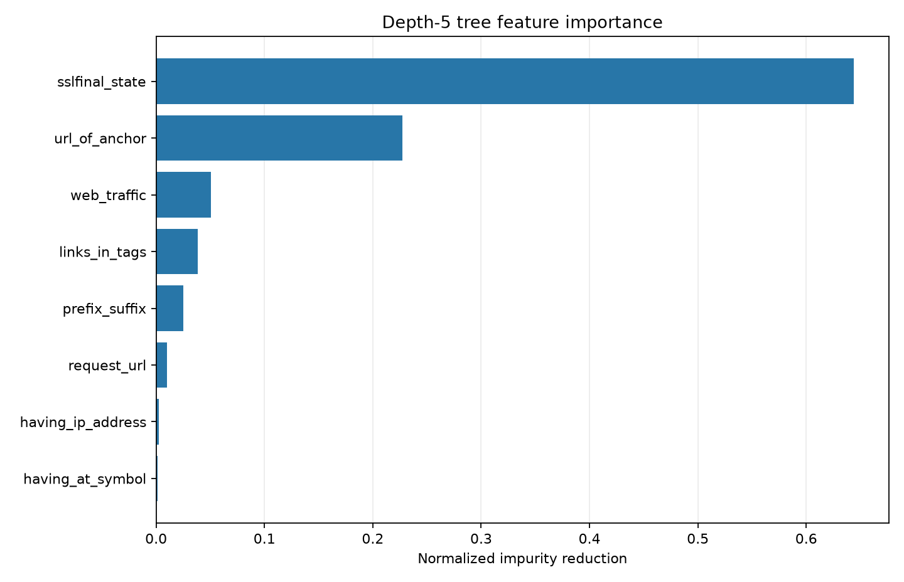

# PhishGuard ML: comparing an entropy tree and K-nearest neighbors

**COMP 151 Artificial Intelligence — final research report**

**Dataset:** UCI Phishing Websites (ID 327)

**Evaluation:** fixed, group-safe train/validation/test split; seed 42

## 1. Problem and motivation

This project asks whether two classroom machine-learning methods can distinguish phishing from legitimate websites using precomputed website characteristics. I compared an entropy-based decision tree with K-nearest neighbors (KNN) and a majority-class baseline. The goal was a reproducible comparison on a historical dataset, not a system for checking live websites. I focused on the phishing class because missing a phishing site and falsely flagging a legitimate site have different consequences: the former could leave a harmful page unrecognized, while the latter could disrupt access to a legitimate page. The experiment measures both errors without assigning them invented monetary costs.

## 2. Dataset and its 30 characteristics

The [UCI Phishing Websites dataset](https://archive.ics.uci.edu/dataset/327/phishing+websites) has **11,055 rows**, **30 integer-coded features**, and one target column, `result`. The inputs are already extracted values, mostly `-1` and `1`, with `0` present in some features; `redirect` uses `0` and `1`. These are categorical codes rather than raw URL lengths, page text, or website files. No missing feature or target values were found. [Checkpoint 1](CHECKPOINT_1_DATASET_INTAKE.md) records every feature's observed values and counts.

| Feature family | Original UCI feature names |
| --- | --- |
| Address bar (12) | `having_ip_address`, `url_length`, `shortining_service`, `having_at_symbol`, `double_slash_redirecting`, `prefix_suffix`, `having_sub_domain`, `sslfinal_state`, `domain_registration_length`, `favicon`, `port`, `https_token` |
| Abnormality (6) | `request_url`, `url_of_anchor`, `links_in_tags`, `sfh`, `submitting_to_email`, `abnormal_url` |
| HTML and JavaScript (5) | `redirect`, `on_mouseover`, `rightclick`, `popupwindow`, `iframe` |
| Domain and reputation (7) | `age_of_domain`, `dnsrecord`, `web_traffic`, `page_rank`, `google_index`, `links_pointing_to_page`, `statistical_report` |

The raw targets are **4,898 `-1`** and **6,157 `1`**. I use the project's declared interpretation **`-1 = phishing`, `1 = legitimate`**, while preserving the original numbers. That interpretation is supported by the authors' feature coding and by [Stevanović's account of the 11,055-row dataset](https://casopisi.junis.ni.ac.rs/index.php/FUMathInf/article/download/11279/pdf), but UCI's current metadata and ARFF header do not explicitly map the numeric *target* to class names. [Hutchinson et al.](https://eudl.eu/pdf/10.1007/978-3-030-00557-3_46) describe the same-sized UCI dataset with the **opposite** target mapping. The disagreement is unresolved. The numerical results below are reproducible for raw class `-1`; calling that class “phishing” is a stated research assumption. [Checkpoint 1B](CHECKPOINT_1B_EVALUATION_PROTOCOL.md) examines the evidence in detail.

## 3. Data quality and group-safe splitting

Only **5,785 distinct 30-feature vectors** occur among the 11,055 rows. There are **5,270 rows beyond the first occurrence** of each vector. More seriously, **64 feature-vector groups, covering 357 rows**, contain both target labels. Identical precomputed features can therefore describe observations with different labels; the available data cannot tell whether the cause is coarse features, different underlying sites, or labeling mistakes. I kept every row and label.

To reduce leakage, I grouped rows by an exact match across all 30 features, without using the target to form groups. A fixed seed of **42** assigned whole groups to training, validation, and test partitions, targeting 70% / 15% / 15%. The resulting row counts were **7,676 / 1,629 / 1,750** (69.43% / 14.74% / 15.83%). Every row was assigned once, and no exact feature vector crossed partitions. Group sizes prevent exact row percentages. The 64 conflicting groups also stayed intact within their assigned partitions. [Checkpoint 1B](CHECKPOINT_1B_EVALUATION_PROTOCOL.md) gives the split protocol and class proportions.

## 4. Algorithms and parameter configurations

The baseline always predicts the majority label learned from **training rows only**, which was `1`. The decision tree was scikit-learn's `DecisionTreeClassifier(criterion="entropy", random_state=42)` with maximum depths **3**, **5**, and **unrestricted**. Although it uses entropy, this binary-threshold tree is **not exact ID3**. KNN used **3**, **5**, and **9** neighbors with uniform voting and Hamming distance. Hamming distance counts the fraction of the 30 feature categories that differ; a difference between `-1` and `0` counts the same as a difference between `-1` and `1`. No scaling or new feature extraction was added.

I fitted each configuration on training data and compared settings on validation data only. KNN with **9 neighbors was selected before the final test**, because it had the highest validation phishing F1. The locked final comparison also retained the unrestricted tree (highest F1 among trees), the depth-5 tree (for interpretation and overfitting analysis), and the baseline. No setting was selected using the test results. [Checkpoint 3B](CHECKPOINT_3B_TEST_PROTOCOL.md) records the lock.

## 5. Entropy, information gain, and feature importance

The training-label entropy was **0.991752 bits**. For each discrete feature, I calculated its individual information gain as `H(result) − Σᵥ P(feature=v) H(result | feature=v)`, using only observed training values. `url_of_anchor` ranked first at **0.483167 bits**, just ahead of `sslfinal_state` at **0.480436 bits**; `prefix_suffix` followed at **0.119782 bits**. For `url_of_anchor`, the three value groups contributed **0.027662**, **0.414074**, and **0.066849** weighted bits of conditional entropy. Their sum, **0.508585**, subtracted from **0.991752**, gives the measured **0.483167-bit** gain. The [top-10 information-gain chart](../results/checkpoint3a/information_gain_top10.png) and [full analysis data](../results/checkpoint3a/analysis.json) show all 30 features.

The depth-5 tree's normalized `feature_importances_` ranked `sslfinal_state` (**0.644120**), `url_of_anchor` (**0.227321**), and `web_traffic` (**0.050573**) highest. This measure sums a feature's weighted impurity reductions across nodes and normalizes the totals. Individual information gain instead asks how much one feature separates labels by itself at the root, grouping all observed values. Tree thresholds, earlier splits, and correlated features can change the ranking. Neither measure proves that a characteristic causes phishing. The [tree-importance chart](../results/checkpoint3a/tree_depth5_importance.png) and [first three tree levels](../results/checkpoint3a/tree_first_three_levels.png) provide readable views; [Checkpoint 3A](CHECKPOINT_3A_FEATURE_ANALYSIS.md) gives the full comparison.

## 6. Training and validation experiments

With **`pos_label=-1`**, I measured phishing precision, recall, and F1 on validation rows. The majority baseline reached **0.5783 accuracy** but **0 phishing F1**, because it never predicted `-1`. The small parameter comparison was:

| Configuration | Validation accuracy | Phishing precision | Phishing recall | Phishing F1 |
| --- | ---: | ---: | ---: | ---: |
| Majority baseline | 0.5783 | 0.0000 | 0.0000 | 0.0000 |
| Entropy tree, depth 3 | 0.9202 | 0.9877 | 0.8210 | 0.8967 |
| Entropy tree, depth 5 | 0.9386 | 0.9819 | 0.8705 | 0.9228 |
| Entropy tree, unrestricted | 0.9355 | 0.9122 | 0.9374 | 0.9246 |
| KNN, k=3 | 0.9411 | 0.9352 | 0.9243 | 0.9297 |
| KNN, k=5 | 0.9411 | 0.9391 | 0.9199 | 0.9294 |
| **KNN, k=9** | **0.9546** | 0.9609 | 0.9301 | **0.9453** |

These are validation scores used for comparison and selection, not independent final estimates. The complete validation confusion matrices and one-run prediction timings are in [Checkpoint 2](CHECKPOINT_2_VALIDATION.md).

## 7. Final held-out test results

After a separate preflight confirmed the UCI source, schema, assignments, group isolation, four frozen model settings, and metric label order, I fitted the four locked models on **training rows only** and performed one planned evaluation on the **1,750 test rows**. [Checkpoint 3C](CHECKPOINT_3C_FINAL_EVALUATION.md) describes the gate; [the saved JSON](../results/checkpoint3c/final_evaluation.json) contains exact results.

| Frozen model | Accuracy | Phishing precision | Phishing recall | Phishing F1 | Predict time (s) |
| --- | ---: | ---: | ---: | ---: | ---: |
| Majority baseline | 0.5526 | 0.0000 | 0.0000 | 0.0000 | 0.000293 |
| Entropy tree, depth 5 | 0.9211 | 0.9562 | 0.8633 | 0.9074 | 0.000534 |
| Entropy tree, unrestricted | 0.9200 | 0.9004 | 0.9234 | 0.9117 | 0.000650 |
| **KNN, k=9** | **0.9251** | 0.9347 | 0.8953 | **0.9145** | 0.301622 |

KNN k=9 retained the highest F1 in this test, narrowly above the unrestricted tree (**0.9145** versus **0.9117**). Prediction times cover only one `predict` call per model and depend on hardware and load; they are descriptive rather than a stable speed ranking.

## 8. Confusion matrices and error analysis

Matrices below use **actual rows `[-1, 1]` and predicted columns `[-1, 1]`**. With the working `-1 = phishing` mapping, the layout is `[[TP, FN], [FP, TN]]`.

| Model | Confusion matrix | Missed phishing (FN) | Legitimate flagged (FP) |
| --- | --- | ---: | ---: |
| Majority baseline | `[[0,783],[0,967]]` | 783 | 0 |
| Entropy tree, depth 5 | `[[676,107],[31,936]]` | 107 | 31 |
| Entropy tree, unrestricted | `[[723,60],[80,887]]` | 60 | 80 |
| KNN, k=9 | `[[701,82],[49,918]]` | 82 | 49 |

The unrestricted tree missed the fewest raw `-1` rows, but it falsely flagged more raw `1` rows than the other trained models. The depth-5 tree made fewer false alarms while missing more `-1` rows. KNN fell between them on those two error counts. Missing a phishing site could leave a harmful page unrecognized; falsely flagging a legitimate site could impose unnecessary review or block access if someone misused the model operationally. This research does not set a decision threshold or claim these observed costs are equal.

## 9. Overfitting and generalization

The unrestricted tree had **0.9892 training accuracy** and **0.9879 training phishing F1**, versus **0.9355** and **0.9246** on validation: gaps of **5.36** and **6.33 percentage points**. Its depth reached 19 with 392 leaves. That train/validation comparison suggests overfitting more strongly than validation accuracy alone would. For KNN k=9, training versus validation was **0.9660 versus 0.9546 accuracy** and **0.9615 versus 0.9453 F1**, smaller gaps. The depth-5 tree's validation scores exceeded its training scores in this particular split, which can arise from differing group composition; it does not prove that the smaller tree generalizes everywhere.

All three trained models scored lower on the final test than validation. KNN's F1 fell by **3.07 percentage points** (**0.9453 → 0.9145**); the unrestricted tree fell by **1.29 points**, and the depth-5 tree by **1.55 points**. These differences show why the validation winner's score should not be presented as final performance. They do not justify changing the locked choice after the test.

## 10. Limitations and conclusions

On this group-separated historical dataset, both trained methods substantially exceeded the majority baseline, and validation-selected KNN k=9 had the highest final test phishing F1 (**0.9145**). The unrestricted tree's stronger training fit did not produce the best test F1. The feature analysis highlights `url_of_anchor` and `sslfinal_state` as informative in this sample, without establishing causation.

The benchmark has important limits. Its features were precomputed from websites collected around the early 2010s, so these scores do not measure present-day phishing detection. Repeated vectors and contradictory labels limit what the 30 values can explain. Grouping prevents exact-vector leakage but cannot establish independence of domains or collection periods because raw identities and timestamps are unavailable. Finally, the target-class naming dispute means the **phishing-class interpretation** remains an assumption even though the raw numeric metrics and matrices are fixed. This is a course research comparison, not an enforcement boundary or a security guarantee.

## 11. References and reproducibility

- Mohammad, R. & McCluskey, L. (2012). [*Phishing Websites*](https://archive.ics.uci.edu/dataset/327/phishing+websites) [Dataset]. UCI Machine Learning Repository. DOI: [10.24432/C51W2X](https://doi.org/10.24432/C51W2X). CC BY 4.0.
- Mohammad, R., Thabtah, F., & McCluskey, L. [*Phishing Websites Features*](https://eprints.hud.ac.uk/id/eprint/24330/6/MohammadPhishing14July2015.pdf). Feature definitions; it does not explicitly define the numeric `result` target.
- Stevanović, N. (2025). [*Embedding and Weighting of Website Features for Phishing Detection*](https://casopisi.junis.ni.ac.rs/index.php/FUMathInf/article/download/11279/pdf). Reports 4,898 phishing and 6,157 legitimate cases for this dataset.
- Hutchinson, S., et al. (2018). [*Detecting Phishing Websites with Random Forest*](https://eudl.eu/pdf/10.1007/978-3-030-00557-3_46). Gives the conflicting numeric class interpretation.
- Project evidence: [dataset intake](CHECKPOINT_1_DATASET_INTAKE.md), [split and label review](CHECKPOINT_1B_EVALUATION_PROTOCOL.md), [validation](CHECKPOINT_2_VALIDATION.md), [feature analysis](CHECKPOINT_3A_FEATURE_ANALYSIS.md), [test lock](CHECKPOINT_3B_TEST_PROTOCOL.md), and [final evaluation](CHECKPOINT_3C_FINAL_EVALUATION.md).

The repository contains the loader, group-safe splitter, model configurations, analysis scripts, offline tests, and saved final results. From the repository root, `python -m pytest -q` runs the offline suite. The final test script is `python -m scripts.final_evaluation`; it refuses to overwrite the checked-in `results/checkpoint3c/final_evaluation.json`. Read that saved JSON to inspect this completed one-time evaluation rather than rerunning it. Re-fetching UCI data for a fresh reproduction requires network access and the dependency versions in `requirements.txt`; a changed source order or library behavior requires verification against the locked protocol.
